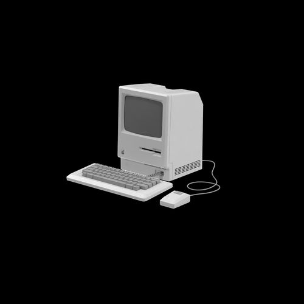

<p align="center">
  
</p>

<h1 align="center">Portfólio<br><sub><sup><sup><sub>Copyright (©) 2026 Erik Pimenta. Todos os direitos reservados.</sub></sup></sup></sub></h1>

<p align="center">
Meu portfólio técnico: quem eu sou, o que estudo e os sistemas que construí do zero, com foco em arquitetura, escalabilidade e consistência de dados, reunidos em uma página só, em português, inglês, francês e espanhol.<br>
Feito com HTML5, CSS e JavaScript puros: sem framework, sem build e sem dependências. A aba Atividade busca dados ao vivo na API pública do GitHub.
</p>

<p align="center">
HTML5 · CSS3 · JavaScript (ES6+) · API do GitHub · 4 idiomas · Responsivo · Zero dependências
</p>

<p align="center">
  <a href="https://ravelroot.github.io"><b>ravelroot.github.io</b></a><br>
  <a href="https://ravelroot.github.io/?lang=en">English</a> · <a href="https://ravelroot.github.io/?lang=fr">Français</a> · <a href="https://ravelroot.github.io/?lang=es">Español</a>
</p>

---

<p align="center">
  
</p>

<p align="center"><b>Quatro idiomas: o site em inglês, com o menu de idiomas aberto</b></p>

<p align="center">
  
</p>

<p align="center"><b>Aba Destaques</b></p>

<p align="center">
  
</p>

<p align="center"><b>Tema claro, na aba Habilidades</b></p>

<p align="center">
  
</p>

<p align="center"><b>Aba Atividade</b></p>

<p align="center">
  
</p>

<p align="center"><b>Aba Notas</b></p>

<p align="center">
  
</p>

<p align="center"><b>Aba Documentação</b></p>

<p align="center">
  
</p>

## O que tem na página

- **Topo fixo** com o ícone de computador e o nome **ravel** digitado letra por letra e cursor piscando (um clique volta ao início), que ganha fundo desfocado ao rolar a página. À direita ficam o atalho para o **GitHub**, o botão **Contato**, que abre a aba Contato de qualquer ponto da página, o **seletor de idioma** (globo com a sigla do idioma atual) e o botão de tema.
- **Tema claro e escuro**: o botão redondo no canto superior direito (☀ sol / ☾ lua) troca a página entre o tema escuro (padrão) e o claro, inspirado em **desenho técnico de engenharia**: fundo de papel com quadriculado bem fraco, texto e destaques em grafite, a mesma linguagem dos diagramas dos PDFs. A paleta é Papel `#E8ECEA` (fundo, etiquetas e barra do terminal), Folha `#F6F8F7` (cartões e corpo do terminal), Linha `#B9C4C2` (bordas), Ardósia `#46535A` (textos de apoio, abas fechadas e botões ao passar o mouse) e Grafite `#20282D` (títulos, textos, botões, aba aberta, cursor do título, prompt do terminal, quadriculado, traço dos diagramas na aba Documentação e barras de linguagens). O gráfico de contribuições e a cidade da aba Atividade vão do papel ao grafite, passando por Linha e Ardósia. Os três botões coloridos do terminal continuam como no tema escuro. O tema escuro usa o mesmo quadriculado de engenharia no fundo, em linhas brancas bem fracas. A escolha fica salva no navegador e volta na próxima visita, sem piscar o tema errado ao carregar.
- **Quatro idiomas: português, inglês (EUA), francês e espanhol**: o botão com o globo, entre **Contato** e o tema, abre um menu com os quatro idiomas, cada um no próprio nome (*Português (Brasil)*, *English (US)*, *Français* e *Español*), e um clique troca o site inteiro na hora, sem recarregar a página: topo, apresentação, terminal, abas, os seis estudos de caso, projetos, habilidades, notas, documentação, a aba Atividade (datas, meses, números e o tempo relativo no formato de cada idioma), formulário de contato, rodapé, título da aba do navegador e textos lidos por leitores de tela. A aba aberta, o tema e o que já foi digitado no formulário continuam onde estavam. A escolha fica salva no navegador e vai para o endereço (`?lang=en`, `?lang=fr` ou `?lang=es`; o português não leva parâmetro), então um link como `ravelroot.github.io/?lang=en` já abre em inglês e pode ser mandado direto para recrutadores de fora. Só o pacote do idioma escolhido é baixado, na primeira vez que ele é pedido; se faltar alguma tradução, o texto aparece em português em vez de quebrar. A mensagem enviada pelo formulário continua chegando em português, com um campo **idioma** que mostra em qual idioma a pessoa escreveu.
- **Apresentação** pensada para quem está contratando: o selo **Disponível para novas oportunidades** (com um pulso curto no ponto verde ao carregar), o nome em tamanho grande, o cargo (*Engenheiro de Software*), um parágrafo sobre o que eu construo, os botões **Ver projetos** e **Entrar em contato** e, embaixo, o GitHub, o e-mail (um clique copia o endereço e o botão mostra *E-mail copiado*) e a localização.
- **Terminal `root@ravel:~$`** com o `ravel --info` do Ravel OS: o que priorizo e as áreas em que atuo, com base nos meus projetos. A primeira linha mostra a versão atual do portfólio (*Ravel OS [Version 1.43.0]*), a mesma do arquivo `VERSION`.
- **Sete abas: Destaques, Projetos, Habilidades, Atividade, Notas, Documentação e Contato**: as seções ficam em abas separadas na mesma página, com sublinhado animado na aba ativa. Ao rolar a página, a fileira de abas **fica presa logo abaixo do topo**, com o mesmo fundo desfocado, e trocar de aba lá embaixo leva ao começo da nova aba. Dá para trocar com o mouse ou pelas setas do teclado, e a página sempre abre na aba Destaques, a não ser que o link já aponte para outra: `ravelroot.github.io/#contato`, `#destaques`, `#habilidades` e assim por diante abrem direto na aba (o endereço volta ao normal em seguida). No celular, a fileira de abas rola para o lado, a aba ativa sempre fica à vista e a borda some aos poucos do lado em que ainda há abas.
  - **Projetos** em cartões com **vitrine no estilo do terminal**: o caminho do repositório no GitHub, a linguagem principal e o ícone do projeto em tamanho grande sobre um pontilhado. Abaixo vêm a categoria em destaque (por exemplo, *Pagamentos e checkout*), o nome, a descrição, as etiquetas de tecnologias e os botões **Código no GitHub** (repositório) e **Manual técnico** (PDF, nos projetos que têm). São meus principais repositórios públicos, de pagamentos e microsserviços a um banco de dados em C++. Os projetos que também estão na aba Destaques (Crivo, Grafo, Nexo, Talos, Bento e Turno) trazem, ao lado da categoria, a etiqueta **Estudo de caso**, que leva direto ao projeto lá; o Crivo e o Grafo, que têm versão no navegador, abrem também com o botão **Abrir demo**. Acima da grade ficam os **filtros por linguagem** (Todos, Python, TypeScript, Java, JavaScript, C#, C++, Go, C e Rust, com o número de projetos em cada um), montados sozinhos a partir das tecnologias; ao filtrar, a etiqueta da linguagem escolhida fica realçada em cada cartão e o contador mostra quantos projetos aparecem. Os cartões **entram um a um** quando surgem na tela (e de novo a cada filtro). Ao passar o mouse, uma luz suave acompanha o cursor, o pontilhado se acende em volta dele, o ícone ganha um leve brilho, e um cursor pisca ao lado do repositório; o cartão não cresce, para o texto continuar nítido. Tudo respeita `prefers-reduced-motion`.
  - **Destaques**: o **Crivo**, o **Grafo**, o **Nexo**, o **Talos**, o **Bento** e o **Turno** apresentados em detalhe, um depois do outro. No topo, um atalho para cada um (ícone, categoria e versão) rola até ele, em três colunas no computador e duas no tablet (quando sobra um, ele ocupa a fileira inteira). Cada projeto abre com a posição (*Destaque 01 / 06*), a categoria, a versão, o nome em tamanho grande, uma frase que resume o projeto e os botões **Abrir no navegador** (no Crivo e no Grafo, que têm versão no GitHub Pages), **Código no GitHub**, **Manual técnico** e **Arquitetura do BD** (quando o projeto tem o PDF do banco). Depois vêm: a **tela principal numa janela** com a barra do terminal e o endereço do projeto (a versão online, o servidor local ou o instalador do Windows), que **acompanha o tema da página** (tela escura no tema escuro, clara no claro); **quatro números** (por exemplo, *301 testes, todos passando*, *37 KB de núcleo em WebAssembly* e *600 mil iterações de PBKDF2 por senha*); **A ideia**, em três parágrafos, ao lado das **tecnologias** agrupadas; uma **galeria** com legenda (nove telas no Talos e no Bento, onze no Nexo, catorze no Grafo, quinze no Crivo e cinco no Turno); **Por dentro**, com as decisões de engenharia numeradas (oito no Crivo, no Grafo, no Nexo e no Talos e seis no Bento e no Turno) (algumas com um trecho no estilo do terminal, como o RLE do Crivo, os modelos do Grafo em duas linhas, os cortes de relevância e o streaming do Nexo, a matriz de prioridade e a mescla do Talos, o LISTEN/NOTIFY do Bento e o token de despacho do Turno); a **arquitetura** desenhada num terminal; e a tabela de **testes e verificações** com os resultados da última rodada de cada projeto. Um clique na tela principal ou em qualquer foto abre o **visualizador**: a imagem quase em tela cheia, com legenda, posição (*04 / 10*), botões e setas do teclado para passar (ele dá a volta no fim), deslize no celular, Esc ou clique fora para fechar e o foco de volta na foto. A aba termina com **Seis projetos, as mesmas regras** (começam com dois cliques, testados a cada push, fechados por padrão e feitos para quem chega), a contagem dos projetos que ficaram de fora e um botão que volta para a aba Projetos. O Bento, que não está na aba Documentação, leva os PDFs no próprio destaque. Os blocos sobem e aparecem conforme a página rola, e tudo respeita `prefers-reduced-motion`.
  - **Habilidades** organizadas por área (Front-end, Back-end, Bancos de Dados, IA & LLMs e Ferramentas), em cartões com um ícone para cada área, o número de itens e etiquetas agrupadas. IA & LLMs se divide em Arquitetura RAG e Modelos e protocolos; Ferramentas, em DevOps e infraestrutura, APIs, Desenvolvimento e Produtividade. Qualquer etiqueta se destaca ao passar o mouse (borda e texto acesos, com o cursor de clique), sem levar a outra aba. Acima dos cartões, os botões **Todas** e **Usadas nos projetos** deixam as demais etiquetas apagadas. Os cartões entram um a um ao aparecer na tela, as etiquetas acendem em cascata e uma luz suave acompanha o mouse.
  - **Atividade**: dados ao vivo do GitHub, buscados só quando a aba é aberta. O cartão **Contribuições** abre no **ano atual**, de 1º de janeiro até hoje, e tem um botão para cada ano desde **2016** (**2026 · 2025 · … · 2016**; um botão novo aparece sozinho a cada virada de ano). Os anos sem nenhum commit aparecem com o calendário inteiro vazio, e os anos anteriores à criação da conta nem gastam consulta à API. Para cada ano, mostra o total de contribuições, os dias com contribuições, a maior sequência de dias seguidos e o número de repositórios públicos, com o **gráfico de contribuições** (o mesmo calendário do perfil, em tons neutros que acompanham o tema); no ano em andamento, os dias que ainda não chegaram aparecem vazados, a nota abaixo do gráfico diz o período exato e, com a aba aberta, o ano atual se atualiza sozinho a cada 5 minutos. Logo abaixo, a **cidade de contribuições** desenha o mesmo ano em 3D isométrico: um prédio por dia, mais alto quanto mais contribuições, com janelas acesas nos dias mais fortes e o dia mais ativo marcado no alto do prédio. Ao lado ficam o total, os dias ativos, o dia mais ativo, a sequência atual (*Sequência no fim do ano* nos anos que já acabaram), a maior sequência e o mês mais ativo, e a cidade muda junto com o botão de ano. Por fim, as **linguagens mais usadas** pela soma do código de todos os repositórios (as oito maiores e *Outras*) e os **cinco repositórios que receberam commits por último**, com o ícone e o nome do projeto quando ele está no portfólio. Passar o mouse sobre um dia, um prédio ou uma linguagem mostra os detalhes, e o rodapé diz a hora da última atualização.
  - **Notas**: textos curtos sobre as decisões técnicas por trás dos projetos (o problema, a escolha feita e o que ela custa), em **duas colunas** no computador e uma no celular. Cada cartão abre com uma vitrine no estilo do terminal, com o bloco de código da própria nota (ou uma frase dela, quando a nota não tem código), seguida do tema em destaque, do tempo de leitura (calculado pelo número de palavras), do título, de um resumo e das etiquetas dos projetos citados, com ícone e link para o repositório. Ao passar o mouse, uma luz suave acompanha o cursor, o código sobe um pouco e a seta do botão avança. Quando o número de notas é ímpar, a última ocupa a fileira inteira, com a vitrine ao lado do texto. O botão **Ler nota** (ou um clique na vitrine) abre a nota inteira num painel por cima da página, com a posição dela no topo (por exemplo, 07 / 08), com blocos de código quando ajudam a explicar e os botões **Anterior** e **Próxima** para seguir lendo. O painel fecha no X, com Esc ou com um clique fora dele, e o foco volta ao cartão da última nota lida. As notas atuais: *Fila não é banco de dados* (Turno e Delco), *Dinheiro é inteiro* (Doca), *Concorrência otimista com número de revisão* (Crivo), *Índice invertido: buscar sem LIKE* (Sonda), *RAG: a resposta depende da busca* (Nexo), *Um banco por serviço* (Argo), *Embaralhar sem viés* (Grimório) e *Boundary tags: liberar memória em O(1)* (Favo).
  - **Documentação**: um cartão por projeto com a miniatura do diagrama do banco (tirada do próprio PDF, em traço branco no tema escuro e grafite no claro), a decisão de arquitetura que mais pesou, etiquetas com os números principais e botões que abrem o **Manual técnico** e a **Arquitetura do BD** em PDF no GitHub. A miniatura também abre o PDF. O Talos, que ainda não tem o PDF do banco, mostra o diagrama de relacionamentos da área de atendimento (as tabelas em volta de `pyh_ticket`), desenhado a partir do diagrama Mermaid de `docs/banco-de-dados.md` do próprio repositório.
  - **Contato**: formulário com **nome**, **sobrenome**, **e-mail para resposta**, **motivo do contato** (Proposta de trabalho, Projeto freelance, Dúvida sobre um projeto, Parceria ou colaboração ou Outro assunto) e **mensagem** (até 3.000 caracteres, com contador). Ao enviar, a mensagem chega no e-mail **ravelroot@outlook.com** pelo [FormSubmit](https://formsubmit.co), sem servidor próprio; o e-mail recebido traz o motivo no assunto, e responder a ele já vai para o endereço de quem escreveu. Enquanto envia, o botão mostra *Enviando…*; depois, o formulário dá lugar a uma confirmação com o botão **Enviar outra mensagem**. Se o envio falhar, aparece um link `mailto:` com a mensagem já preenchida. Um campo invisível barra robôs. Ao lado do formulário (embaixo, no celular), o cartão **Contato direto** traz o e-mail com botão **Copiar**, o GitHub e a localização com o fuso (UTC−3), para quem prefere escrever do próprio e-mail. No celular, os campos usam 16 px, para o iPhone não ampliar a página ao tocar neles.
- **Escala fixa de 75% no computador**: a página já abre do tamanho que teria com o zoom do Chrome em 75%, sem o visitante precisar ajustar nada. No celular (até 768 px de largura) ela fica em 100%, para o texto continuar legível.
- **Rodapé** com GitHub, e-mail e **Voltar ao topo**.
- **Layout responsivo**: duas colunas no computador, uma no celular, sem rolagem lateral.
- **Entrada rápida**: a página aparece com um esmaecer curto logo que carrega (sem a espera de antes) e, sem JavaScript, aparece direto.
- **Prévia ao compartilhar o link**: título, descrição e a imagem `assets/compartilhar.png` (1200 × 630) aparecem no WhatsApp, LinkedIn, Discord e afins; para os buscadores, a página traz os dados de pessoa (nome, cargo, GitHub, cidade e idiomas) em JSON-LD, aponta as quatro versões com `hreflang` (`pt-BR`, `en-US`, `fr` e `es`) e troca o endereço canônico junto com o idioma aberto.
- **Teclado e leitores de tela**: o primeiro Tab mostra **Pular para o conteúdo**, o nome é o título principal da página (`h1`) e os avisos (como *E-mail copiado*) são lidos em voz alta. O menu de idiomas abre com Enter, Espaço ou as setas, anda pelas setas, Home e End, fecha com Esc (o foco volta ao botão) e avisa o leitor de tela quando o idioma muda, já no idioma novo; o atributo `lang` da página acompanha a escolha.
- **Acessível a quem prefere menos movimento**: com `prefers-reduced-motion`, as animações são desligadas.

## De onde vêm os dados da aba Atividade

| Dado | Fonte |
| --- | --- |
| Perfil, repositórios e linguagens | [API pública do GitHub](https://docs.github.com/rest) (`/users/ravelroot`, `/users/ravelroot/repos` e `/repos/.../languages`) |
| Gráfico e cidade de contribuições | [github-contributions-api.jogruber.de](https://github.com/grubersjoe/github-contributions-api), que lê o calendário do perfil, um ano inteiro por vez (`?y=2026`) |
| Outros anos (botões de ano) | O mesmo serviço, com `?y=2025`, `?y=2024` e assim por diante até 2016; os anos que já acabaram ficam guardados por 24 horas, e os anteriores à criação da conta são montados vazios, sem consulta |
| Plano B do gráfico | Eventos públicos dos últimos 90 dias (`/users/ravelroot/events/public`), usados se o calendário não responder |

- Não precisa de token. A API do GitHub permite 60 consultas por hora sem login. A primeira visita do dia gasta cerca de 20 (uma por repositório para contar as linguagens); depois disso, o perfil e os repositórios ficam guardados no navegador por **30 minutos**, a conta das linguagens por **24 horas** (refeita antes só se a lista de repositórios mudar) e o ano atual por **5 minutos**, então cada atualização gasta só 2.
- Se o GitHub limitar as consultas, a aba mostra os últimos dados salvos e avisa o horário. Sem nenhum dado salvo, aparece um cartão com link para o perfil.
- Os repositórios `ravelroot.github.io` e `ravelroot` ficam de fora da lista de repositórios recentes.
- O gráfico de contribuições conta os commits feitos com o e-mail da conta, inclusive os da rotina diária em `.github/workflows/diario.yml`.

## Idiomas

O português é o idioma de origem: os textos ficam onde sempre estiveram (`index.html` e os arquivos de dados em `js/`). Cada tradução fica num arquivo em `js/idiomas/`, que só é baixado quando alguém escolhe aquele idioma.

```js
I18n.registrar("en", {
	ui: { "aba.projetos": "Projects", "projetos.total": { "um": "{n} project", "outros": "{n} projects" } },
	conteudo: {
		projetos: { "Velo": { "categoria": "Payments and checkout", "descricao": "..." } },
		habilidades: { "tela": { "titulo": "Front-end", "grupos": [...] } },
		documentacao: { "Velo": { "decisao": "...", "texto": "...", "destaques": [...] } },
		notas: { "fila-nao-e-banco": { "titulo": "...", "corpo": [...] } },
		destaques: { "Crivo": { "frase": "...", "historia": [...], "galeria": [...] } },
		emComum: { "titulo": "...", "itens": [...] }
	}
});
```

- **Ao incluir ou mudar um texto em português**, acrescente a mesma chave (ou o mesmo projeto, nota ou destaque) nos três arquivos de `js/idiomas/`. Projetos, documentação e destaques são encontrados pelo `titulo`, habilidades pelo `icone` e notas pelo `id`; listas (parágrafos, legendas, testes) seguem a mesma ordem do português. O que não tiver tradução aparece em português.
- **Textos com número** usam `{ "um": "...", "outros": "..." }` e `{n}` no lugar do número (no francês, o singular vale para 0 e 1). Marcas como `{titulo}` e `{ano}` são trocadas pelo valor na hora.
- Os nomes de tecnologias, os links, as imagens e as versões não entram nas traduções: vêm sempre dos arquivos em português.
- Depois de mudar uma tradução, aumente o `VERSAO_PACOTES` em `js/i18n.js`, para o navegador de quem visita baixar os arquivos novos.
- **Para um idioma novo**, acrescente uma linha em `IDIOMAS` (`js/i18n.js`), crie `js/idiomas/<código>.js` copiando um dos existentes e inclua o `hreflang` correspondente no `index.html`.

## Projetos apresentados

| Projeto | O que é | Tecnologias |
| --- | --- | --- |
| [**Velo**](https://github.com/ravelroot/Payment-and-Checkout-System) | Velo é um sistema de pagamento desenvolvido em Java 21, Spring Boot 4 (REST, Security, JPA, Flyway) que integra catálogo, carrinho, cupons, pedidos e meios de pagamento (cartão, PIX e boleto simulados ou Stripe), com gestão de usuários e painel administrativo. Com suporte a H2, PostgreSQL, MySQL, MariaDB, SQL Server e Oracle. | Java 21 · Spring Boot 4 · React 19 · TypeScript · Flyway · 6 bancos de dados |
| [**Talos**](https://github.com/ravelroot/Information-Technology-Service-Management) | Talos é um sistema desktop de ITSM, helpdesk e inventário de ativos em Java 21 com Spring Boot (JPA e Flyway) e interface JavaFX. Arquitetura hexagonal inspirada no GLPI: chamados, problemas, mudanças, SLA, ações em lote, mescla, Kanban e Gantt. Banco à escolha (PostgreSQL, MySQL, MariaDB, SQL Server, Oracle ou H2) e instalador .exe via jpackage. | Java 21 · Spring Boot 4 · JavaFX 21 · JPA · Flyway · Arquitetura hexagonal · 6 bancos de dados |
| [**Doca**](https://github.com/ravelroot/Order-and-Inventory-System) | Doca é uma plataforma de gestão de pedidos, compras e estoque multi-depósito, desenvolvida com Python e FastAPI. Oferece reserva transacional de estoque, custo médio ponderado, análises ABC, giro e reposição, além de painel web com controle de acesso, auditoria, PostgreSQL, Docker e integração contínua. | Python · FastAPI · SQLAlchemy 2 · Alembic · PostgreSQL ou SQLite · Docker · GitHub Actions |
| [**Nexo**](https://github.com/ravelroot/Retrieval-Augmented-QA-System) | Nexo é uma plataforma de agentes de IA com RAG em Python, FastAPI e LlamaIndex, com interface React + TypeScript. Cada agente responde só com a própria base (PDF, Word, EPUB, PowerPoint, planilhas e mais), citando trecho e página, com reranking, respostas em tempo real e WhatsApp. Suporta ChromaDB, Qdrant, Ollama, OpenAI e Cohere. | Python · FastAPI · LlamaIndex · ChromaDB/Qdrant · Ollama/OpenAI · React 19 · TypeScript |
| [**Turno**](https://github.com/ravelroot/Distributed-Task-Processing-Engine) | Turno é um motor de agendamento e processamento de tarefas distribuídas em C# e .NET 10, no estilo Hangfire. Workers clonados consomem filas do RabbitMQ ou Azure Service Bus via MassTransit, com lock Redlock no Redis, Polly (retry, circuit breaker e fila de erros), PostgreSQL e painel em Blazor WebAssembly em tempo real. | C# · .NET 10 · MassTransit · RabbitMQ ou Azure Service Bus · Redis (Redlock) · PostgreSQL · Blazor · Docker |
| [**Sonda**](https://github.com/ravelroot/Inverted-Index-Search-Engine) | Sonda é um motor de busca de texto completo escrito do zero em C# e .NET 10, no estilo Lucene e Elasticsearch. Indexa .txt, .md e .html em paralelo com TPL, aplica stemming RSLP e Porter, grava um índice invertido binário e ordena por BM25 ou TF-IDF, com "Você quis dizer?", comparação lado a lado dos dois modelos e backup conferido por CRC32. Painel web, API e CLI. | C# · .NET 10 · ASP.NET Core · Task Parallel Library · Brotli · xUnit · Docker |
| [**Argo**](https://github.com/ravelroot/E-commerce-Microservices-Platform) | Argo é uma plataforma de microserviços para vendas com vários vendedores, feita em Django: estoque em tempo real (Redis + SSE), checkout assíncrono com Celery, notas fiscais por um serviço em Java (Spring Boot), banco MySQL, gateway Nginx e Docker Compose. Pronta para usar, com manual e PDF do banco de dados. | Python 3.13 · Django 6 · Django REST Framework · Celery · Redis · MySQL · Java 21 · Spring Boot 4 · Nginx · Docker |
| [**Delco**](https://github.com/ravelroot/Workflow-Orchestration-Engine) | Delco é um motor de orquestração de workflows em Python e Django, no estilo Airflow/Temporal: pipelines como código, agendamento cron, worker pool em Redis Streams, retentativas e retomada exata após quedas. API em Django REST Framework, painel em tempo real com Django Channels, MySQL, Docker e Pytest. | Python 3.13 · Django 6 · Django REST Framework · Channels · MySQL · Redis Streams · Docker |
| [**Crivo**](https://github.com/ravelroot/Pixel-Art-Matrix-Editor) | Crivo é um editor de pixel art e engine de jogos 2D no navegador, em JavaScript puro. Matriz RGBA, camadas com modos de mistura, animação, histórico ilimitado e exportação para PNG, GIF, .ase e sprite sheets. Estúdio de jogo com cenas, atores, eventos, física e scripting em C++, Lua e Crivo Script, exportado em HTML. Desktop, API Django e CLI Java. | JavaScript · Canvas 2D · Web Audio · Python 3.13 · Django 6.1 · PostgreSQL 17 · Java 21 · Go + WebView2 · Docker |
| [**Lume**](https://github.com/ravelroot/Document-Library-Desktop) | Lume é uma biblioteca de PDFs e DOCX em Java 21 + Spring Boot 4, com capas automáticas (PDFBox), descrição por IA, leitor próprio, estantes, coleções e busca em texto completo (SQLite FTS5). Um único Lume.exe portátil, com o Java embutido. | Java 21 · Spring Boot 4 · SQLite + FTS5 · Apache PDFBox · pdf.js · Playwright |
| [**Grafo**](https://github.com/ravelroot/Collaborative-Design-and-Diagram-Editor) | Grafo é um editor colaborativo de design e diagramas no navegador, em JavaScript com PixiJS (WebGL2 e WebGPU) e núcleo geométrico em C++ compilado para WebAssembly. Frames, auto layout, componentes, UML, ER e BPMN, 63 modelos e 46 padrões prontos, protótipo clicável e edição em tempo real com Yjs, servidor em Rust, PostgreSQL, Redis e NATS. | JavaScript · PixiJS 8 · C++17 → WebAssembly · Rust (Axum + Tokio) · Yjs/Yrs · PostgreSQL 17 · Redis 7 · NATS JetStream · Go + WebView2 · Docker |
| [**Favo**](https://github.com/ravelroot/Custom-Memory-Allocator) | Favo é um alocador de memória escrito do zero em C11 que substitui o malloc e o free do sistema: pede memória ao kernel com sbrk e mmap (VirtualAlloc no Windows), alinha blocos a 16 bytes, aloca por First-Fit, Next-Fit ou Best-Fit em árvore rubro-negra e funde vizinhos livres. Funciona via LD_PRELOAD, com API em FastAPI e painel web do heap ao vivo. | C11 · sbrk e mmap · CMake · LD_PRELOAD · Python 3.13 · FastAPI · WebSocket · SQLite · TypeScript · Vite · Docker |
| [**Bento**](https://github.com/ravelroot/Data-Driven-Admin-Panel) | Bento é um painel administrativo SaaS em bento grid feito com Tailwind CSS v4: modo claro/escuro salvo no localStorage, KPIs com tendência, gráficos ApexCharts, tabelas com ordenação, busca, paginação e visões salvas, e gavetas laterais com notas internas. API em TypeScript (Fastify) com PostgreSQL, JWT, permissões por papel, alertas em tempo real (SSE) e relatórios em CSV e PDF. | TypeScript · Tailwind CSS 4 · ApexCharts · Node.js 22 · Fastify 5 · Zod · PostgreSQL 18 ou PGlite · PDFKit · Docker |
| [**Apogeu**](https://github.com/ravelroot/Multi-Agent-Orchestration-System) | Apogeu é um orquestrador de agentes de IA em LangGraph: um supervisor coordena pesquisador, redator e revisor que colaboram para produzir artigos com fontes. Function calling, gestão de contexto, engenharia de prompts, aprovação humana do plano e streaming ao vivo numa interface Next.js. Roda com OpenAI, Anthropic, Ollama ou modo demonstração. | Python 3.11+ · LangGraph · LangChain · FastAPI · SQLite · Next.js 16 · React 19 · TypeScript · Go + WebView2 |
| [**Arca**](https://github.com/ravelroot/Persistent-Key-Value-Server) | Arca é um banco de dados em C++20 com LSM-Tree: WAL com group commit, memtable em skip list, SSTables com filtro de Bloom e compactação em níveis. Servidor TCP assíncrono compatível com o protocolo do Redis, tabelas com SQL, snapshots MVCC, API REST em Go e painel web em React. | C++20 · CMake · RESP2 · Go 1.24 · React 18 · TypeScript · Vite · Prometheus · Docker |
| [**Leme**](https://github.com/ravelroot/Distributed-Key-Value-CLI) | Leme é uma CLI em Go e Cobra para operar um cluster distribuído de armazenamento chave-valor: modo interativo (REPL com histórico e autocompletar) e direto para scripts, roteamento por hash consistente, réplicas com quórum, protocolo binário sobre TCP com TLS, nós de referência, console web e saída em tabela ou JSON. | Go 1.24 · Cobra · TCP com protocolo binário · TLS 1.2+ e mTLS · JavaScript · OpenAPI 3.1 · Kubernetes · Prometheus · Docker |

## Como rodar

Não há nada para instalar.

**Windows:** dê dois cliques em `visualizar.bat`. A página abre no seu navegador padrão.

**Qualquer sistema:** abra o arquivo `index.html` no navegador.

A aba Atividade precisa de internet para buscar os dados no GitHub; o resto da página funciona offline.

Se preferir servir por HTTP (útil para testar como ficará publicado):

```bash
python -m http.server 8080
```

Depois acesse **<http://localhost:8080>**.

### Ativar o formulário de contato

O FormSubmit só entrega mensagens depois de uma ativação, feita uma vez:

1. Publique a página e envie uma mensagem de teste pela aba **Contato** do site publicado (aberto como arquivo, pelo `visualizar.bat`, o envio não funciona).
2. Abra o e-mail **ravelroot@outlook.com** e clique em **Activate Form** na mensagem do FormSubmit (se não aparecer, olhe a caixa de spam).
3. A partir daí, cada envio chega como e-mail, com os campos numa tabela.

O mesmo e-mail de ativação traz um código aleatório que pode substituir o endereço em `CONTATO.destino` e no `action` do formulário, para o e-mail não ficar visível no código da página.

## Como personalizar

| Quero mudar... | Onde |
| --- | --- |
| Nome, selo de disponibilidade, cargo, apresentação, terminal e rodapé | `index.html` (as versões em inglês, francês e espanhol ficam em `js/idiomas/`, nas chaves `apresentacao.*`, `terminal.*` e `rodape.*`) |
| Versão no terminal (*Ravel OS [Version 1.43.0]*) | `index.html`, na primeira linha do `.terminal-corpo`; acompanha o número do arquivo `VERSION` |
| Imagem que aparece ao compartilhar o link | `assets/compartilhar.png` (1200 × 630), citada nas tags `og:image` e `twitter:image` do `index.html` |
| Descrição que aparece ao compartilhar o link (WhatsApp, LinkedIn, Discord etc.) | `index.html`, nas tags `<meta name="description">` e `<meta property="og:description">` |
| Tamanho geral da página (escala) | `css/estilo.css`: o zoom de 75% fica em `zoom: 0.75;` na `.pagina`, dentro do `@media (min-width: 769px)` (a dica do gráfico e o quadriculado do fundo têm os tamanhos reduzidos no mesmo bloco); o tamanho base do texto fica em `font-size: 80%;` no `html` |
| Lista de projetos e categoria de cada um | `js/projetos.js`, no vetor `PROJETOS` |
| Botão **Abrir demo** e etiqueta **Estudo de caso** dos cartões de projeto | `js/destaques.js`: o projeto precisa ter um item em `DESTAQUES` (com o mesmo `titulo`), e o endereço da demo fica em `online` |
| Linguagens que viram filtro na aba Projetos | `js/main.js`, na lista `LINGUAGENS` (só aparecem as que algum projeto usa, em ordem de quantidade) |
| Habilidades e tecnologias | `js/habilidades.js`, no vetor `HABILIDADES` (o campo `icone` escolhe o desenho do cartão entre `tela`, `servidor`, `banco`, `ia` e `ferramentas`, definidos em `ICONES_AREAS`, em `js/main.js`); uma etiqueta fica marcada como usada quando tem o mesmo nome de uma tecnologia em `js/projetos.js` |
| Quadriculado do fundo | `css/estilo.css`, na variável `--grade` (uma vez em cada tema) |
| Decisão de arquitetura, etiquetas e links dos PDFs de cada projeto | `js/documentacao.js`, no vetor `DOCUMENTACAO` |
| Notas (tema, título, resumo, texto, frase da vitrine e projetos citados) | `js/notas.js`, no vetor `NOTAS` |
| Aba Destaques (projetos, frase, números, textos, tecnologias, fotos e legendas, decisões de engenharia, arquitetura, testes e o bloco final) | `js/destaques.js`, nos vetores `DESTAQUES` e `DESTAQUES_EM_COMUM`; o `titulo` de cada destaque precisa ser igual ao de `js/projetos.js` e de `js/documentacao.js`, de onde vêm o ícone, a categoria, o repositório e os PDFs; um projeto que não está nessas abas leva esses dados no próprio destaque, em `projeto` (`categoria`, `icone` e `link`) e `documentos` (`manual` e `banco`), como o Bento faz com os PDFs, já que não está na aba Documentação. O endereço da barra da janela fica em `endereco`, e `online` é opcional. Os ícones dos itens do bloco final (`tela`, `build`, `escudo` e `livro`) ficam em `ICONES_AREAS`, em `js/main.js` |
| Fotos da aba Destaques | `assets/destaques/`, uma pasta por projeto (`crivo/`, `grafo/`, `nexo/`, `talos/`, `bento/` e `turno/`): as telas em WebP em 16:10 (1440 × 900 ou 1600 × 1000, usadas na capa e no visualizador) e, em `mini/`, as miniaturas de 800 × 500 da galeria, todas convertidas das imagens de `docs/images/` de cada repositório (a capa escura do Crivo é a mesma tela do Estúdio de jogo da capa clara, capturada no tema escuro). As telas de 1440 × 960 do Nexo, do Bento e do Turno foram reduzidas para 900 de altura e completadas nas laterais com a cor do fundo do próprio app, sem cortar nada; a tela de contas do Nexo é um recorte de 1440 × 900 da página Sistema e conta, que é mais alta |
| Luz que segue o mouse nos cartões de projeto e de nota, brilho do ícone grande e fundo escurecido atrás do leitor | `css/estilo.css`, nas variáveis `--luz`, `--brilho-icone` e `--fundo-leitor` (uma vez em cada tema) |
| Miniaturas dos diagramas | `assets/documentacao/` (PNG branco com fundo transparente, 1100 × 420) |
| Usuário do GitHub, tempos de cache, quantos repositórios e linguagens mostrar, repositórios escondidos e ano inicial dos botões de ano | `js/atividade.js`, no objeto `ATIVIDADE` (`anoInicial`, hoje 2016: o último botão de ano e o começo do calendário mais antigo; `reposOcultos` lista os repositórios que não entram em *Repositórios recentes*) |
| Tons do gráfico de contribuições, da cidade e das barras de linguagens | `css/estilo.css`, nas variáveis `--nivel-0` a `--nivel-4`, `--barra` e `--barra-outras` (uma vez em cada tema) |
| Cores, fontes, espaçamentos e animações | `css/estilo.css` (variáveis em `:root`) |
| Cores do tema claro | `css/estilo.css`, no bloco `:root[data-tema="claro"]` |
| Botão de tema (ícones e textos) | `index.html`, no `#botao-tema`, e `js/main.js`, em `alternarTema()` |
| Idiomas disponíveis (nome, sigla e formato de datas e números) | `js/i18n.js`, na lista `IDIOMAS` |
| Textos da interface em português | Os do HTML ficam no próprio `index.html`, nos elementos com `data-i18n` (texto) e `data-i18n-attr` (atributos, como `aria-label` e `placeholder`); os montados pelo JavaScript ficam em `js/i18n.js`, no pacote `pt` |
| Traduções para inglês, francês e espanhol | `js/idiomas/en.js`, `js/idiomas/fr.js` e `js/idiomas/es.js`: `ui` traz os textos da interface (com as mesmas chaves do português) e `conteudo` traz projetos, habilidades, documentação, notas e destaques |
| Seletor de idioma (botão e menu) | `index.html`, no `#idioma`; o comportamento fica em `js/main.js`, em `montarSeletorDeIdioma()`, e o visual em `css/estilo.css`, nas classes `.botao-idioma` e `.menu-idioma` |
| Animação do título e do topo | `js/main.js` |
| Abas (nomes e textos de cada seção) | `index.html`, nos botões `.aba` e nos painéis `#painel-destaques`, `#painel-projetos`, `#painel-habilidades`, `#painel-atividade`, `#painel-documentacao`, `#painel-notas` e `#painel-contato`; o comportamento fica em `js/main.js`, em `alternarAbas()`; os nomes e textos nos outros idiomas ficam em `js/idiomas/`, nas chaves `aba.*` e `painel.*` |
| Formulário de contato (e-mail que recebe, campos e motivos) | E-mail de destino: `js/contato.js`, em `CONTATO.destino`, e no `action` do `#contato-form` em `index.html`; campos, motivos e textos: `index.html`, no `#painel-contato` (o `value` de cada motivo fica em português, para o e-mail chegar sempre igual; o texto visível é traduzido pelas chaves `contato.*` de `js/idiomas/`) |

Todo texto que mudar em português precisa da mesma mudança nos três arquivos de `js/idiomas/` (veja [Idiomas](#idiomas)); sem ela, o texto aparece em português nos outros idiomas.

Depois de alterar um arquivo CSS ou JS, aumente o número de `?v=` nos links do `index.html` (por exemplo, de `?v=2` para `?v=3`). Assim o navegador de quem visita baixa a versão nova em vez de usar a antiga guardada em cache.

Para incluir um projeto novo, basta acrescentar um item:

```js
{
	titulo: "Meu Projeto",
	categoria: "O que ele é, em duas ou três palavras",
	icone: "assets/projetos/meu-projeto.png",
	descricao: "O que ele faz, em uma ou duas frases.",
	link: "https://github.com/ravelroot/Meu-Projeto",
	tecnologias: ["Python", "FastAPI"]
}
```

O `icone` é opcional: use um PNG quadrado, branco e com fundo transparente em `assets/projetos/` (ele aparece pequeno nas outras abas e grande na vitrine do cartão). A primeira tecnologia da lista é tratada como a linguagem principal e aparece na vitrine. O botão **Manual técnico** usa o `manual` do item de mesmo `titulo` em `js/documentacao.js`; quando o projeto não está lá, vale o `manual` do próprio item (opcional) ou o dos `documentos` do destaque, e sem nenhum deles o cartão mostra só **Código no GitHub**. Se o projeto também estiver em `js/destaques.js`, o cartão ganha a etiqueta **Estudo de caso**. O botão **Abrir demo** aparece quando o destaque ou o próprio item tem `online`, com o endereço da versão no navegador (como o Crivo).

Para o projeto aparecer também na aba Documentação, acrescente um item com o **mesmo `titulo`** em `js/documentacao.js` (o ícone vem de `js/projetos.js`):

```js
{
	titulo: "Meu Projeto",
	miniatura: "assets/documentacao/meu-projeto.png",
	miniaturaDescricao: "Diagrama de relacionamentos das tabelas do Meu Projeto",
	decisao: "A decisão de arquitetura em poucas palavras",
	texto: "Por que essa decisão foi tomada, em duas ou três frases.",
	destaques: ["PostgreSQL", "12 tabelas"],
	manual: "https://github.com/ravelroot/Meu-Projeto/blob/main/Manual-Meu-Projeto.pdf",
	banco: "https://github.com/ravelroot/Meu-Projeto/blob/main/Banco-de-Dados-Meu-Projeto.pdf"
}
```

O `banco` é opcional: sem ele, o cartão mostra só o botão do manual.

Para escrever uma nota nova, acrescente um item em `js/notas.js`, com um `id` curto e único (é por ele que as traduções encontram a nota). Em `corpo`, cada texto vira um parágrafo e cada `{ codigo: "..." }` vira um bloco de código; os nomes em `projetos` precisam ser iguais aos `titulo` de `js/projetos.js`. Com `projetos: []`, a nota aparece sem etiquetas (útil para projetos que não estão na aba Projetos). A posição no vetor define a ordem das notas e o contador do leitor. A vitrine do cartão mostra o primeiro bloco de código; `citacao` é opcional e põe uma frase no lugar do código (sem código e sem `citacao`, entra a primeira frase do texto):

```js
{
	id: "titulo-da-nota",
	titulo: "Título da nota",
	tema: "Arquitetura",
	resumo: "Uma frase que diz do que a nota trata.",
	corpo: [
		"Primeiro parágrafo.",
		{ codigo: "SELECT 1;" },
		"Último parágrafo."
	],
	citacao: "Uma frase curta da nota para a vitrine (opcional).",
	projetos: ["Meu Projeto"]
}
```

## Estrutura

```
Portfolio/
├── index.html          estrutura da página
├── css/
│   └── estilo.css      temas escuro e claro, apresentação, abas fixas, escala de 75%, layout responsivo e animações
├── js/
│   ├── i18n.js         troca de idioma: textos da interface em português, formatos de data e número, pacotes de tradução e endereço com ?lang=
│   ├── idiomas/        traduções completas do site: en.js (inglês dos EUA), fr.js (francês) e es.js (espanhol)
│   ├── projetos.js     dados dos projetos
│   ├── habilidades.js  habilidades por área
│   ├── documentacao.js decisão de arquitetura e PDFs de cada projeto
│   ├── atividade.js    busca os dados do GitHub e monta a aba Atividade: contribuições por ano, cidade, linguagens e repositórios recentes
│   ├── notas.js        textos da aba Notas
│   ├── destaques.js    Crivo, Grafo, Nexo, Talos, Bento e Turno em detalhe: textos, números, fotos, arquitetura e testes da aba Destaques
│   ├── contato.js      envia o formulário da aba Contato para o e-mail pelo FormSubmit
│   └── main.js         monta os cartões, os filtros dos projetos, a aba Destaques com o visualizador de imagens e o leitor das notas, digita o título, copia o e-mail, controla o topo, as abas (inclusive pelos links com #aba), o seletor de idioma e o tema
├── assets/
│   ├── logo-ravel.png  logo
│   ├── icone-computador.png  ícone do topo, ao lado do nome
│   ├── projetos/       ícones dos projetos (brancos, fundo transparente)
│   ├── destaques/      telas dos seis destaques em WebP (crivo/, grafo/, nexo/, talos/, bento/ e turno/, com as miniaturas em mini/)
│   ├── documentacao/   miniaturas dos diagramas de banco, tiradas dos PDFs (a do Talos vem do diagrama Mermaid de docs/banco-de-dados.md)
│   ├── favicon.png     ícone da aba
│   ├── compartilhar.png  imagem da prévia ao compartilhar o link (1200 × 630)
│   ├── preview-portfolio.png        prévia do tema escuro usada neste README
│   ├── preview-portfolio-claro.png  prévia do tema claro usada neste README
│   ├── preview-portfolio-idiomas.png  prévia do site em inglês, com o menu de idiomas aberto
│   ├── preview-portfolio-documentacao.png  prévia da aba Documentação
│   ├── preview-portfolio-destaques.png     prévia da aba Destaques
│   ├── preview-portfolio-atividade.png     prévia da aba Atividade
│   └── preview-portfolio-notas.png         prévia da aba Notas
├── .github/
│   ├── workflows/diario.yml  5 commits automáticos por dia, com rodada de reserva
│   └── atividade.txt         registro dos commits automáticos
├── VERSION             versão do portfólio, a mesma do terminal
├── LICENSE             todos os direitos reservados
└── visualizar.bat      abre a página no navegador (Windows)
```

[](https://github.com/ravelroot)

## Licença

**Todos os direitos reservados.** O código, os textos, as imagens e o design deste portfólio pertencem a Erik Pimenta. Nenhuma licença de uso é concedida: é proibido copiar, usar, modificar, redistribuir ou publicar qualquer parte sem autorização por escrito. Veja os termos completos em [LICENSE](LICENSE). Pedidos de autorização: ravelroot@outlook.com.
