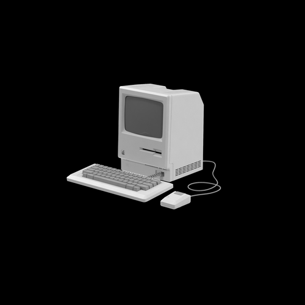

<p align="center">
  
</p>

<h1 align="center">Portfólio<br><sub><sup><sup><sub>Copyright (©) 2026 Erik Pimenta</sub></sup></sup></sub></h1>

<p align="center">
Meu portfólio técnico: quem eu sou, o que estudo e os sistemas que construí do zero, com foco em arquitetura, escalabilidade e consistência de dados, reunidos em uma página só.<br>
Feito com HTML5, CSS e JavaScript puros: sem framework, sem build e sem dependências. A aba Atividade busca dados ao vivo na API pública do GitHub.
</p>

<p align="center">
HTML5 · CSS3 · JavaScript (ES6+) · API do GitHub · Responsivo · Zero dependências
</p>

<p align="center">
  <a href="https://ravelroot.github.io"><b>ravelroot.github.io</b></a>
</p>

---

<p align="center">
  
</p>

<p align="center"><b>Tema claro, na aba Habilidades</b></p>

<p align="center">
  
</p>

<p align="center"><b>Aba Documentação</b></p>

<p align="center">
  
</p>

<p align="center"><b>Aba Atividade</b></p>

<p align="center">
  
</p>

<p align="center"><b>Aba Notas</b></p>

<p align="center">
  
</p>

## O que tem na página

- **Topo fixo** com o ícone de computador e o nome **ravel** digitado letra por letra e cursor piscando, que ganha fundo desfocado ao rolar a página.
- **Tema claro e escuro**: o botão redondo no canto superior direito (☀ sol / ☾ lua) troca a página entre o tema escuro (padrão) e o claro, inspirado em **desenho técnico de engenharia**: fundo de papel com quadriculado bem fraco, texto e destaques em grafite, a mesma linguagem dos diagramas dos PDFs. A paleta é Papel `#E8ECEA` (fundo, etiquetas e barra do terminal), Folha `#F6F8F7` (cartões e corpo do terminal), Linha `#B9C4C2` (bordas), Ardósia `#46535A` (textos de apoio, abas fechadas e botões ao passar o mouse) e Grafite `#20282D` (títulos, textos, botões, aba aberta, cursor do título, prompt do terminal, quadriculado, traço dos diagramas na aba Documentação e barras de linguagens). O gráfico de contribuições vai do papel ao grafite, passando por Linha e Ardósia. Os três botões coloridos do terminal continuam como no tema escuro. A escolha fica salva no navegador e volta na próxima visita, sem piscar o tema errado ao carregar.
- **Apresentação** com localização, resumo e link discreto para o GitHub, alinhada ao topo do terminal.
- **Terminal `ravel@localhost~`** com o `ravel --info` do Ravel OS: o que priorizo e as áreas em que atuo, com base nos meus projetos.
- **Cinco abas: Projetos, Habilidades, Documentação, Atividade e Notas**: as seções ficam em abas separadas na mesma página, com sublinhado animado na aba ativa. Dá para trocar com o mouse ou pelas setas do teclado, e a última aba aberta fica salva no navegador. No celular, a fileira de abas rola para o lado e a aba ativa sempre fica à vista.
  - **Projetos** em cartões com o ícone de cada projeto antes do nome, descrição, etiquetas de tecnologias e link para cada repositório.
  - **Habilidades** organizadas por área (Front-end, Back-end, Bancos de Dados, IA & LLMs e Ferramentas), em cartões com etiquetas agrupadas. IA & LLMs se divide em Arquitetura RAG e Modelos e protocolos; Ferramentas, em DevOps e infraestrutura, APIs, Desenvolvimento e Produtividade.
  - **Documentação**: um cartão por projeto com a miniatura do diagrama do banco (tirada do próprio PDF, em traço branco no tema escuro e grafite no claro), a decisão de arquitetura que mais pesou, etiquetas com os números principais e botões que abrem o **Manual técnico** e a **Arquitetura do BD** em PDF no GitHub. A miniatura também abre o PDF. O Talos, que ainda não tem o PDF do banco, mostra um esquema da arquitetura hexagonal.
  - **Atividade**: dados ao vivo do GitHub, buscados só quando a aba é aberta. Mostra as contribuições dos últimos 12 meses, sequência atual e maior sequência de dias com commits, número de repositórios públicos, o **gráfico de contribuições** dos últimos 12 meses (o mesmo calendário do perfil, em tons neutros que acompanham o tema). A janela anda junto com o tempo e atravessa a virada de ano: por isso o primeiro mês e cada janeiro mostram o ano, e a nota abaixo do gráfico diz o período exato. A partir de **1º de janeiro de 2027**, o cartão ganha sozinho os botões **12 meses · 2027 · 2026** para ver cada ano inteiro (um botão novo aparece a cada virada de ano); no ano em andamento, os dias que ainda não chegaram aparecem vazados, as **linguagens mais usadas** pela soma do código de todos os repositórios e os **repositórios que receberam commits por último**, com o ícone do projeto quando ele está no portfólio. Passar o mouse sobre um dia ou uma linguagem mostra os detalhes.
  - **Notas**: textos curtos sobre as decisões técnicas por trás dos projetos (o problema, a escolha feita e o que ela custa), em lista de uma coluna. Cada nota mostra o tema, o tempo de leitura (calculado pelo número de palavras), o título, um resumo e etiquetas dos projetos citados, com ícone e link para o repositório. O botão **Ler nota** abre o texto completo dentro do próprio cartão, com blocos de código quando ajudam a explicar. As notas atuais: *Fila não é banco de dados* (Turno e Delco), *Dinheiro é inteiro* (Doca), *Concorrência otimista com número de revisão* (Crivo), *Índice invertido: buscar sem LIKE* (Sonda), *RAG: a resposta depende da busca* (Nexo) e *Um banco por serviço* (Argo).
- **Escala fixa de 75% no computador**: a página já abre do tamanho que teria com o zoom do Chrome em 75%, sem o visitante precisar ajustar nada. No celular (até 768 px de largura) ela fica em 100%, para o texto continuar legível.
- **Layout responsivo**: duas colunas no computador, uma no celular, sem rolagem lateral.
- **Acessível a quem prefere menos movimento**: com `prefers-reduced-motion`, as animações são desligadas.

## De onde vêm os dados da aba Atividade

| Dado | Fonte |
| --- | --- |
| Perfil, repositórios e linguagens | [API pública do GitHub](https://docs.github.com/rest) (`/users/ravelroot`, `/users/ravelroot/repos` e `/repos/.../languages`) |
| Gráfico de contribuições | [github-contributions-api.jogruber.de](https://github.com/grubersjoe/github-contributions-api), que lê o calendário do perfil |
| Ano inteiro (botões de ano) | O mesmo serviço, com `?y=2026`, `?y=2027` e assim por diante; anos que já acabaram ficam guardados por 24 horas |
| Plano B do gráfico | Eventos públicos dos últimos 90 dias (`/users/ravelroot/events/public`), usados se o calendário não responder |

- Não precisa de token. A API do GitHub permite 60 consultas por hora sem login. A primeira visita do dia gasta cerca de 15 (uma por repositório para contar as linguagens); depois disso, a resposta fica guardada no navegador por **30 minutos** e a conta das linguagens por **24 horas**, então cada atualização gasta só 2.
- Se o GitHub limitar as consultas, a aba mostra os últimos dados salvos e avisa o horário. Sem nenhum dado salvo, aparece um cartão com link para o perfil.
- O gráfico de contribuições conta os commits feitos com o e-mail da conta, inclusive os da rotina diária em `.github/workflows/diario.yml`.

## Projetos apresentados

| Projeto | O que é | Tecnologias |
| --- | --- | --- |
| [**Velo**](https://github.com/ravelroot/Payment-and-Checkout-System) | Velo é um sistema de pagamento desenvolvido em Java 21, Spring Boot 4 (REST, Security, JPA, Flyway) que integra catálogo, carrinho, cupons, pedidos e meios de pagamento (cartão, PIX e boleto simulados ou Stripe), com gestão de usuários e painel administrativo. Com suporte a H2, PostgreSQL, MySQL, MariaDB, SQL Server e Oracle. | Java 21 · Spring Boot 4 · React 19 · TypeScript · Flyway · 6 bancos de dados |
| [**Talos**](https://github.com/ravelroot/Information-Technology-Service-Management) | Talos é um sistema desktop de ITSM, helpdesk e inventário de ativos em Java 21 com Spring Boot (JPA e Flyway) e interface JavaFX. Arquitetura hexagonal inspirada no GLPI: chamados, problemas, mudanças, SLA, regras de negócio, Kanban e Gantt. Banco à escolha (PostgreSQL, MySQL, MariaDB, SQL Server, Oracle ou H2) e instalador .msi via jpackage. | Java 21 · Spring Boot 4 · JavaFX 21 · JPA · Flyway · Arquitetura hexagonal · 6 bancos de dados |
| [**Doca**](https://github.com/ravelroot/Order-and-Inventory-System) | Doca é uma plataforma de gestão de pedidos, compras e estoque multi-depósito, desenvolvida com Python e FastAPI. Oferece reserva transacional de estoque, custo médio ponderado, análises ABC, giro e reposição, além de painel web com controle de acesso, auditoria, PostgreSQL, Docker e integração contínua. | Python · FastAPI · SQLAlchemy 2 · Alembic · PostgreSQL ou SQLite · Docker · GitHub Actions |
| [**Nexo**](https://github.com/ravelroot/Retrieval-Augmented-QA-System) | Nexo é um chatbot RAG para manuais técnicos e livros em PDF desenvolvido em Python com FastAPI, LlamaIndex e interface React + TypeScript. Responde com base estrita nos documentos, citando trecho e página, com reranking e cortes de relevância contra alucinações. Com suporte a ChromaDB, Qdrant, Ollama, OpenAI e Cohere. | Python · FastAPI · LlamaIndex · ChromaDB/Qdrant · Ollama/OpenAI · React 19 · TypeScript |
| [**Turno**](https://github.com/ravelroot/Distributed-Task-Processing-Engine) | Turno é um motor de agendamento e processamento de tarefas distribuídas em C# e .NET 10, no estilo Hangfire. Workers clonados consomem filas do RabbitMQ ou Azure Service Bus via MassTransit, com lock Redlock no Redis, Polly (retry, circuit breaker e fila de erros), PostgreSQL e painel em Blazor WebAssembly em tempo real. | C# · .NET 10 · MassTransit · RabbitMQ ou Azure Service Bus · Redis (Redlock) · PostgreSQL · Blazor · Docker |
| [**Sonda**](https://github.com/ravelroot/Inverted-Index-Search-Engine) | Sonda é um motor de busca de texto completo escrito do zero em C# e .NET 10, no estilo Lucene e Elasticsearch. Indexa pastas de .txt, .md e .html em paralelo com TPL e ConcurrentDictionary, aplica tokenização e stemming RSLP e Porter, grava um índice invertido binário via FileStream e ordena por BM25 ou TF-IDF, com painel web, API e CLI. | C# · .NET 10 · ASP.NET Core · Task Parallel Library · Brotli · xUnit · Docker |
| [**Argo**](https://github.com/ravelroot/E-commerce-Microservices-Platform) | Argo é uma plataforma de microserviços para vendas com vários vendedores, feita em Django: estoque em tempo real (Redis + SSE), checkout assíncrono com Celery, notas fiscais por um serviço em Java (Spring Boot), banco MySQL, gateway Nginx e Docker Compose. Pronta para usar, com manual e PDF do banco de dados. | Python 3.13 · Django 6 · Django REST Framework · Celery · Redis · MySQL · Java 21 · Spring Boot 4 · Nginx · Docker |
| [**Delco**](https://github.com/ravelroot/Workflow-Orchestration-Engine) | Delco é um motor de orquestração de workflows em Python e Django, no estilo Airflow/Temporal: pipelines como código, agendamento cron, worker pool em Redis Streams, retentativas e retomada exata após quedas. API em Django REST Framework, painel em tempo real com Django Channels, MySQL, Docker e Pytest. | Python 3.13 · Django 6 · Django REST Framework · Channels · MySQL · Redis Streams · Docker |
| [**Crivo**](https://github.com/ravelroot/Pixel-Art-Matrix-Editor) | Crivo é um editor de pixel art no navegador em JavaScript puro: matriz RGBA via ImageData, balde por varredura, Bresenham e elipse de ponto médio, camadas, animação, simetria e histórico ilimitado com diffs e RLE. Paletas Game Boy, NES, Pico-8 e CGA, tons em OKLCH, PNG, sprite sheet e matrizes JSON/CSV/JS/Python. API Django e CLI Java. | JavaScript · Canvas 2D · Python 3.13 · Django 6.1 · PostgreSQL 17 · Java 21 · Docker |
| [**Lume**](https://github.com/ravelroot/Document-Library-Desktop) | Lume é uma biblioteca de PDFs e DOCX em Java 21 + Spring Boot 4, com capas automáticas (PDFBox), descrição por IA, leitor próprio, estantes, coleções e busca em texto completo (SQLite FTS5). Um único Lume.exe portátil, com o Java embutido. | Java 21 · Spring Boot 4 · SQLite + FTS5 · Apache PDFBox · pdf.js · Playwright |
| [**Bento**](https://github.com/ravelroot/Data-Driven-Admin-Panel) | Bento é um painel administrativo SaaS em bento grid feito com Tailwind CSS v4: modo claro/escuro salvo no localStorage, KPIs com tendência, gráficos ApexCharts, tabelas com ordenação, busca e paginação, e gavetas laterais. API em TypeScript (Fastify) com PostgreSQL, JWT, permissões por papel, alertas em tempo real (SSE) e relatórios em CSV e PDF. | TypeScript · Tailwind CSS 4 · Node.js 22 · Fastify 5 · PostgreSQL 18 ou PGlite · ApexCharts · Docker |

## Como rodar

Não há nada para instalar.

**Windows:** dê dois cliques em `visualizar.bat`. A página abre no seu navegador padrão.

**Qualquer sistema:** abra o arquivo `index.html` no navegador.

A aba Atividade precisa de internet para buscar os dados no GitHub; o resto da página funciona offline.

Se preferir servir por HTTP (útil para testar como ficará publicado):

```bash
python -m http.server 8080
```

Depois acesse **<http://localhost:8080>**.

## Como personalizar

| Quero mudar... | Onde |
| --- | --- |
| Nome, apresentação, terminal e rodapé | `index.html` |
| Descrição que aparece ao compartilhar o link (WhatsApp, LinkedIn, Discord etc.) | `index.html`, nas tags `<meta name="description">` e `<meta property="og:description">` |
| Tamanho geral da página (escala) | `css/estilo.css`: o zoom de 75% fica em `zoom: 0.75;` na `.pagina`, dentro do `@media (min-width: 769px)` (a dica do gráfico e o quadriculado do tema claro têm os tamanhos reduzidos no mesmo bloco); o tamanho base do texto fica em `font-size: 80%;` no `html` |
| Lista de projetos | `js/projetos.js`, no vetor `PROJETOS` |
| Habilidades e tecnologias | `js/habilidades.js`, no vetor `HABILIDADES` |
| Decisão de arquitetura, etiquetas e links dos PDFs de cada projeto | `js/documentacao.js`, no vetor `DOCUMENTACAO` |
| Notas (tema, título, resumo, texto e projetos citados) | `js/notas.js`, no vetor `NOTAS` |
| Miniaturas dos diagramas | `assets/documentacao/` (PNG branco com fundo transparente, 1100 × 420) |
| Usuário do GitHub, tempos de cache, quantos repositórios e linguagens mostrar e ano inicial dos botões de ano | `js/atividade.js`, no objeto `ATIVIDADE` (o ano inicial vem da data de criação da conta; `anoInicial` só é usado se a API não responder) |
| Tons do gráfico de contribuições e das barras de linguagens | `css/estilo.css`, nas variáveis `--nivel-0` a `--nivel-4`, `--barra` e `--barra-outras` (uma vez em cada tema) |
| Cores, fontes, espaçamentos e animações | `css/estilo.css` (variáveis em `:root`) |
| Cores do tema claro | `css/estilo.css`, no bloco `:root[data-tema="claro"]` |
| Botão de tema (ícones e textos) | `index.html`, no `#botao-tema`, e `js/main.js`, em `alternarTema()` |
| Animação do título e do topo | `js/main.js` |
| Abas (nomes e textos de cada seção) | `index.html`, nos botões `.aba` e nos painéis `#painel-projetos`, `#painel-habilidades`, `#painel-documentacao`, `#painel-atividade` e `#painel-notas`; o comportamento fica em `js/main.js`, em `alternarAbas()` |

Depois de alterar um arquivo CSS ou JS, aumente o número de `?v=` nos links do `index.html` (por exemplo, de `?v=2` para `?v=3`). Assim o navegador de quem visita baixa a versão nova em vez de usar a antiga guardada em cache.

Para incluir um projeto novo, basta acrescentar um item:

```js
{
	titulo: "Meu Projeto",
	icone: "assets/projetos/meu-projeto.png",
	descricao: "O que ele faz, em uma ou duas frases.",
	link: "https://github.com/ravelroot/Meu-Projeto",
	tecnologias: ["Python", "FastAPI"]
}
```

O `icone` é opcional: use um PNG quadrado, branco e com fundo transparente em `assets/projetos/`.

Para o projeto aparecer também na aba Documentação, acrescente um item com o **mesmo `titulo`** em `js/documentacao.js` (o ícone vem de `js/projetos.js`):

```js
{
	titulo: "Meu Projeto",
	miniatura: "assets/documentacao/meu-projeto.png",
	miniaturaDescricao: "Diagrama de relacionamentos das tabelas do Meu Projeto",
	decisao: "A decisão de arquitetura em poucas palavras",
	texto: "Por que essa decisão foi tomada, em duas ou três frases.",
	destaques: ["PostgreSQL", "12 tabelas"],
	manual: "https://github.com/ravelroot/Meu-Projeto/blob/main/Manual-Meu-Projeto.pdf",
	banco: "https://github.com/ravelroot/Meu-Projeto/blob/main/Banco-de-Dados-Meu-Projeto.pdf"
}
```

O `banco` é opcional: sem ele, o cartão mostra só o botão do manual.

Para escrever uma nota nova, acrescente um item em `js/notas.js`. Em `corpo`, cada texto vira um parágrafo e cada `{ codigo: "..." }` vira um bloco de código; os nomes em `projetos` precisam ser iguais aos `titulo` de `js/projetos.js`:

```js
{
	titulo: "Título da nota",
	tema: "Arquitetura",
	resumo: "Uma frase que diz do que a nota trata.",
	corpo: [
		"Primeiro parágrafo.",
		{ codigo: "SELECT 1;" },
		"Último parágrafo."
	],
	projetos: ["Meu Projeto"]
}
```

## Estrutura

```
Portfolio/
├── index.html          estrutura da página
├── css/
│   └── estilo.css      temas escuro e claro, abas, escala de 75%, layout responsivo e animações
├── js/
│   ├── projetos.js     dados dos projetos
│   ├── habilidades.js  habilidades por área
│   ├── documentacao.js decisão de arquitetura e PDFs de cada projeto
│   ├── atividade.js    busca os dados do GitHub e monta a aba Atividade
│   ├── notas.js        textos da aba Notas
│   └── main.js         monta os cartões, digita o título, controla o topo, as abas e o tema
├── assets/
│   ├── logo-ravel.png  logo
│   ├── icone-computador.png  ícone do topo, ao lado do nome
│   ├── projetos/       ícones dos projetos (brancos, fundo transparente)
│   ├── documentacao/   miniaturas dos diagramas de banco, tiradas dos PDFs
│   ├── favicon.png     ícone da aba
│   ├── preview-portfolio.png        prévia do tema escuro usada neste README
│   ├── preview-portfolio-claro.png  prévia do tema claro usada neste README
│   ├── preview-portfolio-documentacao.png  prévia da aba Documentação
│   ├── preview-portfolio-atividade.png     prévia da aba Atividade
│   └── preview-portfolio-notas.png         prévia da aba Notas
├── .github/
│   ├── workflows/diario.yml  5 commits automáticos por dia, com rodada de reserva
│   └── atividade.txt         registro dos commits automáticos
└── visualizar.bat      abre a página no navegador (Windows)
```

[](https://github.com/ravelroot)

## Licença

[MIT](LICENSE). Use, copie, altere e distribua à vontade.
